# Compte rendu — TP5 : MLflow et DVC

**Groupe :** À compléter · **Membres :** À compléter · **Date :** 25/11/2026

## 1. Introduction et objectifs

Ce TP met en place le suivi reproductible des entraînements avec MLflow et le versionnement des jeux de données avec DVC. Les runs associent les paramètres, les métriques, le modèle et l'empreinte des données utilisées.

## 2. Environnement technique

| Outil | Version constatée |
|---|---:|
| Python | 3.12.3 (environnement enregistré par MLflow) |
| scikit-learn | 1.8.0 |
| MLflow | 3.18.0 |
| DVC | 3.67.1 |
| pytest | 9.1.1 |

Les versions des dépendances du modèle sont aussi enregistrées dans ses artefacts MLflow (`requirements.txt`, `conda.yaml` et `python_env.yaml`). Les runs locaux sont stockés dans `mlflow.db` et `mlruns/`; ces sorties ne sont pas destinées à Git.

## 3. Sprint 1 — MLflow

### Implémentation de `log_run()`

La fonction choisit l'expérience `maintai`, ouvre un run, enregistre les paramètres et `data_md5`, puis les métriques et le modèle. Elle renvoie l'identifiant MLflow du run :

```python
mlflow.set_experiment(EXPERIMENT)
with mlflow.start_run() as run:
    mlflow.log_params(params)
    mlflow.log_param("data_md5", file_md5(data_path))
    mlflow.log_metrics(metrics)
    mlflow.sklearn.log_model(
        model,
        name="model",
        input_example=X_example,
        skops_trusted_types=TRUSTED_TYPES,
    )
    return run.info.run_id
```

Le code d'entraînement fournit `recall`, `precision`, `accuracy` et `baseline_recall`. L'identifiant renvoyé est celui de `run.info.run_id`.

### Entraînements constatés dans MLflow

Les cinq runs ci-dessous sont présents et terminés. Les quatre premières lignes correspondent aux commandes demandées; la dernière est un entraînement supplémentaire sur la version v2.

| Commande | Données (`data_md5`, préfixe) | Run ID | Recall | Precision | Accuracy |
|---|---|---|---:|---:|---:|
| `python -m maintai.train` | v1 · `73e0b7cb` | `20fa45989e934709a8680aa5e0d9e2f6` | 0.750 | 0.622 | 0.904 |
| `python -m maintai.train --C 0.01` | v1 · `73e0b7cb` | `fd0155c72d54477399994619fc58603a` | 0.691 | 0.653 | 0.908 |
| `python -m maintai.train --threshold 0.2` | v1 · `73e0b7cb` | `b1f06060805b457c9f9c95ceb6666d72` | 0.838 | 0.543 | 0.882 |
| `python -m maintai.train --model forest` | v1 · `73e0b7cb` | `951110b320e345ca95b7374f4b50c7db` | 0.728 | 0.562 | 0.886 |
| Entraînement v2, réglages par défaut | v2 · `93fdeef2` | `bf981c395cdb4a2098389f39b86396b8` | 0.741 | 0.650 | 0.916 |

Les empreintes complètes sont `73e0b7cb3c6f795c70c3ddf970b99c15` (v1) et `93fdeef2cac1893c4f720c16457eea75` (v2). L'expérience d'entraînement `maintai` contient les cinq runs présentés ici. La base locale contient également 30 runs dans l'expérience distincte `maintai-grid-search`, détaillés à la section 10.

### Choix du modèle

Pour le coût métier plus élevé d'une panne manquée, le run de régression logistique avec seuil `0.2` est le choix observé le plus adapté : son recall de `0.838` est le plus élevé des quatre essais demandés. Le compromis est une precision de `0.543` et une accuracy de `0.882`, inférieures à certains autres essais. Cela signifie qu'il faut accepter davantage de fausses alertes. Le choix reste à valider avec les coûts réels et des données représentatives.

Le modèle MLflow enregistre `scikit-learn==1.8.0` dans ses dépendances et sa métadonnée de flavor. Cette version explicite contribue à éviter les écarts de versions entre entraînement et rechargement du modèle.

## 4. Sprint 2 — DVC

Le projet contient `data/sensors.csv.dvc`. Sa version courante référence :

```yaml
outs:
- md5: 93fdeef2cac1893c4f720c16457eea75
  size: 202834
  hash: md5
  path: sensors.csv
```

Les deux objets de données ont été retrouvés dans le cache DVC local et dans le stockage distant configuré :

| Version | Commit Git | MD5 | Lignes |
|---|---|---|---:|
| v1 | `f90df135d4a72f7f0a11330ec416d5727bd0a68e` | `73e0b7cb3c6f795c70c3ddf970b99c15` | 5 000 |
| v2 (courante) | `cfa9616cd380fccdd4baa41a676266fdfd49e392` | `93fdeef2cac1893c4f720c16457eea75` | 8 000 |

`dvc status` indique **Data and pipelines are up to date.** `dvc status -c` indique que le cache et le remote `stockage` sont synchronisés. `dvc push` a réussi et a répondu **Everything is up to date.**

Pour vérifier la récupération sans supprimer de donnée du projet, un essai isolé de `dvc pull` a été effectué dans un dossier temporaire ne contenant que le pointeur DVC et sa configuration. Le fichier a été récupéré depuis le remote : 8 000 lignes et 202 834 octets. Aucun fichier ni cache du projet n'a été supprimé. Cet essai vérifie donc une récupération depuis un cache vide, sans prétendre avoir testé une suppression dans le projet.

Les données volumineuses sont gérées par DVC; Git conserve le petit fichier pointeur `.dvc`. Le chemin du remote local, qui dépend de la machine, se trouve maintenant dans `.dvc/config.local`, ignoré par Git. Il faut un stockage distant partagé pour que les autres membres du groupe puissent récupérer les données.

Le dépôt de groupe confirme l'initialisation `dvc init --subdir` et les pointeurs des deux versions. Dans un clone temporaire de sa branche `tp5`, `dvc pull` a récupéré v2, puis v1; après mise en cache des deux objets, `dvc checkout` a restauré v2 et v1 à la demande. Les MD5 et nombres de lignes obtenus correspondaient aux deux versions ci-dessus. Ce test n'a modifié ni supprimé les données du dossier de travail.

Le stockage disponible ici est un dossier local (`C:\Users\pc\dvc-stockage`), configuré dans `.dvc/config.local`; il n'est pas partagé par Git ni accessible automatiquement aux autres membres. Il faudra un stockage commun (par exemple S3, Azure Blob, SSH ou un partage réseau) pour qu'ils puissent faire `dvc pull`.

## 5. Comparaison v1 / v2

Les deux runs utilisent les réglages par défaut, mais pas les mêmes données ni le même nombre de relevés.

| Run | `data_md5` (8 premiers caractères) | `n_train` | Recall | Precision | Accuracy |
|---|---|---:|---:|---:|---:|
| v1, régression logistique, seuil 0.3 | `73e0b7cb` | 4 000 | 0.750 | 0.622 | 0.904 |
| v2, régression logistique, seuil 0.3 | `93fdeef2` | 6 400 | 0.741 | 0.650 | 0.916 |

On ne peut pas conclure que v2 est globalement meilleur : le recall baisse légèrement, tandis que precision et accuracy augmentent. Les ensembles de données diffèrent et v2 contient plus de relevés; ces métriques ne constituent pas une comparaison contrôlée sur le même jeu de test.

## 6. Tests

Commande exécutée : `python -m pytest -q`

Résultat constaté après l'ajout du Grid Search : **47 passed**, aucune erreur de test. 107 avertissements ont été émis, principalement des avertissements de dépréciation Joblib/NumPy et un avertissement MLflow sur le schéma des colonnes entières; aucun n'a fait échouer la suite. Les 15 tests de `tests/test_grid_search.py` ont également été collectés et exécutés dans cette suite.

## 7. ADR 004

La décision proposée, fondée sur le meilleur recall mesuré pour la contrainte métier, est documentée dans [`docs/adr/004-choix-du-modele.md`](docs/adr/004-choix-du-modele.md). Le run retenu est `b1f06060805b457c9f9c95ceb6666d72`, avec `data_md5=73e0b7cb3c6f795c70c3ddf970b99c15`.

## 8. Vérifications Git et éléments à remettre

Le dépôt de groupe identifié est [`H20-sys/project`](https://github.com/H20-sys/project), chemin `TP/TP5`. L'identification est confirmée par les empreintes exactes des pointeurs DVC v1/v2 et par les fichiers MaintAI. Le dossier local `Downloads/TP5/TP5` n'est pas un clone Git (aucun `.git`); le dépôt parent `issame-ariba/pc` est vide et n'est pas le dépôt TP5. Aucune commande Git n'a utilisé `C:\Users\pc` comme racine de dépôt; le test a utilisé un clone temporaire isolé.

Branches distantes constatées : `main` (`d2de7cb`), `tp5` (`4d7c657`), `tp6`, `tp3`, `TP3` et `tp1-api`. La PR [#4](https://github.com/H20-sys/project/pull/4) est fermée et fusionnée; elle a inclus 40 fichiers sous `TP/TP5`. Les tags existent : `tp4` pointe sur `bde2d11bf6f45068d9e504e0a1536de06e8a4f14` et `tp5` sur `d713580d2509e55067c936ad64f1076c2d141cd2`.

La PR fusionnée contient déjà `COMPTE_RENDU.md`, `docs/adr/004-choix-du-modele.md`, `data/sensors.csv.dvc`, `.dvc/config`, `.dvc/.gitignore`, le code et les tests. Elle n'inclut ni `mlflow.db`, ni `mlruns/`, ni `data/sensors.csv`, ni le cache DVC, ni `config.local`. Le fichier `.dvc/.gitignore` du dépôt exclut `/config.local`, `/tmp` et `/cache`.

**Attention avant une nouvelle PR :** les copies locales de `COMPTE_RENDU.md` et de l'ADR ont des IDs de runs MLflow différents de ceux du compte rendu fusionné de Grp 2 (par exemple `b1f060...` local contre `612c5b17...` dans le dépôt). Elles documentent des bases MLflow distinctes; ne pas remplacer les documents du groupe sans réconcilier ces résultats avec les membres.

À remettre après ajout au bon dépôt :

- le code `maintai/` et les tests `tests/`;
- `COMPTE_RENDU.md` et `docs/adr/004-choix-du-modele.md`;
- `data/sensors.csv.dvc`, `.dvc/config` et les fichiers de projet nécessaires (`README.md`, `requirements.txt`, `pyproject.toml`, `pytest.ini`, `.gitignore`);
- le remote DVC partagé ou ses instructions d'accès, si les enseignants doivent récupérer les données.

Ne pas remettre `mlflow.db`, `mlruns/`, `.dvc/cache/`, `.dvc/config.local` ni le CSV suivi par DVC. La PR #4 est déjà fusionnée; tout changement supplémentaire doit passer par une nouvelle branche et une PR de suivi après comparaison avec les fichiers du groupe.

## 9. Conclusion et tâches restantes

Le suivi MLflow est opérationnel : la base locale contient cinq runs d'entraînement et 30 runs issus de la Grid Search, avec leurs métriques et empreintes des données. Les modèles et fichiers de dépendances des 30 runs Grid Search ont été vérifiés. Les 47 tests passent. Le dépôt de groupe, ses commits de données, ses deux tags et la PR fusionnée ont été retrouvés. DVC `pull` et `checkout` ont été testés dans un clone temporaire, sans toucher aux données du projet.

À compléter avant un éventuel rendu de suivi : travailler dans un clone de `H20-sys/project`, comparer les documents locaux avec ceux déjà fusionnés, puis ouvrir une nouvelle PR seulement si des corrections sont retenues. Configurer un remote DVC partagé avec les membres. Aucun commit, push Git, merge ni tag n'a été créé pendant cet audit.

## 10. Grid Search — recherche bornée des hyperparamètres

### 10.1 Introduction et objectif

Le Grid Search automatise la comparaison de plusieurs configurations des modèles MaintAI. Un entraînement manuel ne permet d'observer qu'un réglage à la fois; une grille fixe facilite la comparaison dans les mêmes conditions de données et de découpage.

L'objectif est de sélectionner un modèle qui détecte les pannes, en donnant la priorité au **Recall**. La limite stricte de 30 configurations borne le temps de calcul et le nombre de nouveaux runs MLflow produits par une exécution. Cette limite s'applique à chaque invocation; elle ne supprime pas les runs historiques.

### 10.2 Méthodologie utilisée

Le module `maintai.grid_search` construit les combinaisons avec `sklearn.model_selection.ParameterGrid`. Il compare une régression logistique et une forêt aléatoire, pour plusieurs paramètres et seuils. Les données sont chargées avec les fonctions existantes, puis séparées selon le découpage reproductible du projet (`random_state=42`). Chaque modèle est entraîné sur le même jeu d'entraînement et évalué sur le même jeu de test.

Pour chaque configuration retenue, le programme calcule Recall, Precision et Accuracy, puis appelle `log_run()` dans l'expérience distincte `maintai-grid-search`. Le logger existant enregistre les paramètres, `data_md5`, les métriques et le modèle avec ses dépendances. Les résultats incluent le Run ID et sont exportés en CSV.

Schéma du traitement :

```text
Grille de 30 configurations au plus
                 |
       Validation de toute la grille
                 |
      Chargement et split déterministe
                 |
     Entraînement puis évaluation
                 |
 Run MLflow dédié + ligne de résultats
                 |
       Sélection Recall, puis Precision
                 |
            Export CSV
```

### 10.3 Code source et explication

**Génération de la grille.** Le produit des listes crée 12 configurations de régression logistique et 18 de forêt, soit 30 au total.

```python
PARAMETER_GRID = list(
    ParameterGrid([
        {
            "model": ["logreg"],
            "C": [0.01, 0.1, 1.0, 10.0],
            "threshold": [0.2, 0.3, 0.5],
        },
        {
            "model": ["forest"],
            "n_estimators": [100, 200],
            "max_depth": [None, 10, 20],
            "threshold": [0.2, 0.3, 0.5],
        },
    ])
)
```

**Validation et plafond.** Le nombre demandé est borné entre 1 et 30. La liste complète est validée avant le premier entraînement : une configuration invalide fait échouer l'appel avant qu'un run soit créé.

```python
_validate_max_runs(max_runs)
if len(candidates) > MAX_RUNS:
    raise ValueError("La grille contient plus de 30 configurations.")

# Valider toute la grille avant de commencer à créer des runs.
validated = [_validate_configuration(config) for config in candidates]
selected = validated[:max_runs]
```

Avec `--max-runs` inférieur à 30, les premières configurations de la grille sont exécutées; aucune sélection aléatoire de sous-grille n'est faite.

**Entraînement, évaluation et suivi.** La fonction `build_model()` existante est réutilisée; les modèles reçoivent la seed fixe du projet. `evaluate()` produit les trois métriques à partir des probabilités et du seuil de la configuration. Le run MLflow est ensuite créé dans l'expérience Grid Search dédiée.

```python
metrics = evaluate(
    model, X_test, y_test, float(config["threshold"]), round_metrics=False
)
run_id = log_run(
    params={**config, "random_state": SEED},
    metrics={key: metrics[key] for key in ("recall", "precision", "accuracy")},
    model=model,
    X_example=X_train.head(3),
    data_path=settings.data_path,
    experiment_name=GRID_SEARCH_EXPERIMENT,
)
```

Les métriques non arrondies sont conservées pour le classement. Le paramètre `data_md5` est calculé dans `log_run()` depuis le fichier de données; les dépendances du modèle sont enregistrées par MLflow comme pour les entraînements existants.

**Sélection et export.** `select_best()` sélectionne d'abord le Recall maximal, puis la Precision maximale. La commande principale écrit les lignes obtenues dans le CSV, par défaut `grid_search_results.csv`.

```python
best = max(results, key=lambda row: (row["Recall"], row["Precision"]))
results.to_csv(args.output, index=False)
```

### 10.4 Hyperparamètres utilisés

| Modèle | Hyperparamètre | Valeurs testées | Rôle |
|---|---|---|---|
| Logistic Regression | `C` | 0.01, 0.1, 1.0, 10.0 | Contrôle l'inverse de la force de régularisation. |
| Logistic Regression | `threshold` | 0.2, 0.3, 0.5 | Seuil de décision appliqué aux probabilités de panne. |
| Random Forest | `n_estimators` | 100, 200 | Nombre d'arbres de la forêt. |
| Random Forest | `max_depth` | `None`, 10, 20 | Profondeur maximale des arbres; `None` ne fixe pas de limite explicite. |
| Random Forest | `threshold` | 0.2, 0.3, 0.5 | Seuil de décision appliqué aux probabilités de panne. |
| Les deux modèles | `random_state` | 42 (fixe) | Rend déterministes le split et les éléments aléatoires du modèle. |

Les valeurs de `C` couvrent plusieurs ordres de grandeur; les profondeurs et nombres d'arbres offrent plusieurs niveaux de complexité. Les seuils couvrent des décisions plus sensibles aux pannes (0.2), le seuil par défaut du projet (0.3) et un seuil plus élevé (0.5). Le code définit ces valeurs, mais ne documente pas d'étude préalable justifiant qu'elles soient optimales : elles constituent une grille d'exploration discrète, pas une recherche exhaustive de tous les réglages possibles. Avec le seed 42, les modèles utilisent également le découpage fixe de `maintai.data.split()`.

### 10.5 Critères d'évaluation

| Métrique | Interprétation pour MaintAI |
|---|---|
| Recall | Part des pannes réelles détectées. Un Recall plus élevé signifie moins de pannes manquées. |
| Precision | Part des alertes qui correspondent effectivement à une panne; elle renseigne sur les fausses alertes. |
| Accuracy | Part totale de prédictions correctes, toutes classes confondues. |

Le Recall est le critère principal, car une panne non détectée peut être plus coûteuse qu'une alerte à vérifier. En cas d'égalité stricte du Recall, la configuration ayant la Precision la plus élevée est retenue. L'Accuracy est affichée pour donner une vue globale, mais ne départage pas les modèles.

### 10.6 Tests et validation

La suite `python -m pytest -q` a été exécutée après l'implémentation et a donné **47 tests réussis** (107 avertissements, aucun échec). Les 15 tests de Grid Search n'exécutent pas une recherche complète ni 30 appels à MLflow : ils remplacent le logger par un faux logger pour observer les appels. Un test de reproductibilité entraîne deux fois une seule configuration forestière; un test de CLI vérifie l'écriture du CSV dans un répertoire temporaire.

| Test | Objectif | Résultat attendu | Résultat obtenu | Statut |
|---|---|---|---|---|
| Taille de la grille | Contrôler le nombre défini de configurations | 30 au maximum | 30 configurations | TERMINÉ |
| Limite de runs | Vérifier le plafonnement et rejeter les valeurs hors limites | Aucun appel supérieur à 30; valeurs invalides rejetées | Valeurs 0, 31 et -1 rejetées; une limite de 2 produit 2 appels au logger simulé | TERMINÉ |
| Configuration invalide | S'assurer qu'une grille invalide échoue avant le suivi | Aucun run pour une configuration invalide | Seuil, paramètres forestiers, modèle inconnu et `C` invalide rejetés avant le logger simulé | TERMINÉ |
| Paramètres, métriques et données | Vérifier la charge transmise au logger | Paramètres incluant la seed, trois métriques et chemin/digest cohérents | Le test unitaire vérifie les arguments simulés; la vérification ultérieure de la base confirme ces paramètres, métriques et le même `data_md5` sur les 30 runs | TERMINÉ |
| Sélection | Prioriser Recall et départager avec Precision | Recall maximal, puis Precision maximale | Test d'égalité du Recall sélectionne la Precision la plus forte | TERMINÉ |
| Reproductibilité | Réentraîner la même configuration avec seed fixe | Métriques identiques | Métriques égales sur deux exécutions du test | TERMINÉ |
| Erreurs et cas limites | Tester entrée vide, grille trop grande, résultats vides et CLI invalide | Erreur explicite, sans run | Cas rejetés; la limite CLI supérieure à 30 est refusée | TERMINÉ |
| Export CSV | Vérifier le fichier et la configuration affichée | CSV lisible et meilleur choix rapporté | CSV lu depuis le chemin temporaire; configuration attendue affichée | TERMINÉ |
| Anciens tests TP5 | Vérifier l'absence de régression | Suite du projet réussie | 47 passed; 107 avertissements | TERMINÉ |
| Conservation des anciens runs | Éviter la suppression ou modification des runs existants | Les anciens runs restent inchangés | Les cinq runs historiques sont toujours `FINISHED` et actifs dans la base; le code n'appelle aucune opération de suppression ou de mise à jour. Aucun test automatisé dédié de non-modification n'est défini. | PARTIEL |

Les contrôles unitaires des runs Grid Search testent le contenu transmis à `log_run()` et ne déclenchent donc pas de recherche complète. Après l'exécution réelle communiquée, la base MLflow a été inspectée en lecture seule : les 30 runs dédiés sont `FINISHED`, contiennent les paramètres et métriques attendus, et partagent le `data_md5` `93fdeef2cac1893c4f720c16457eea75`. Les 30 répertoires de modèle contiennent `model.skops`, `requirements.txt`, `conda.yaml` et `python_env.yaml`. La base contient 35 runs actifs au total; les cinq runs historiques de `maintai` sont toujours présents. Cette vérification après exécution confirme l'état courant, mais ne remplace pas un test automatisé de non-modification avant/après.

### 10.7 Résultats expérimentaux

La Grid Search a été exécutée avec 30 configurations. Les 30 Run IDs affichés à la console correspondent aux 30 lignes du fichier `grid_search_results.csv` et aux 30 runs `FINISHED` de l'expérience `maintai-grid-search` dans la base `mlflow.db`. Aucune configuration n'a été omise. Les métriques ci-dessous sont arrondies à six décimales pour la lisibilité; les valeurs du CSV et de MLflow conservent leur précision enregistrée.

| Run ID | Modèle | Hyperparamètres | Threshold | Recall | Precision | Accuracy |
|---|---|---|---:|---:|---:|---:|
| `b879924cbaaa468da0750ec80775d85c` | Logistic Regression | C=0.01 | 0.2 | 0.829268 | 0.546624 | 0.890000 |
| `fdcd33bf5dea4b118fbea2238d3acb85` | Logistic Regression | C=0.01 | 0.3 | 0.697561 | 0.687500 | 0.920625 |
| `a83dc58c8cee4faf8f1fff803c8192cb` | Logistic Regression | C=0.01 | 0.5 | 0.463415 | 0.833333 | 0.919375 |
| `d4f346582d2041398c0b95827280df43` | Logistic Regression | C=0.1 | 0.2 | 0.829268 | 0.559211 | 0.894375 |
| `9877315827dc4ea696fa966768eef308` | Logistic Regression | C=0.1 | 0.3 | 0.731707 | 0.652174 | 0.915625 |
| `f0418ab981fb4476a226cccf16acbcd0` | Logistic Regression | C=0.1 | 0.5 | 0.565854 | 0.783784 | 0.924375 |
| `c3b7830a09bf4e82919aa73b96c36db6` | Logistic Regression | C=1.0 | 0.2 | 0.824390 | 0.567114 | 0.896875 |
| `5df8bd76ab374d8384a14f1fe88cdd21` | Logistic Regression | C=1.0 | 0.3 | 0.741463 | 0.649573 | 0.915625 |
| `7e5ebf3751e647f2bae8f9f2871fce6d` | Logistic Regression | C=1.0 | 0.5 | 0.580488 | 0.772727 | 0.924375 |
| `3d023ef159ff4dfd9084737752b3c034` | Logistic Regression | C=10.0 | 0.2 | 0.824390 | 0.567114 | 0.896875 |
| `826cfb505fb84f3bba152769069a032a` | Logistic Regression | C=10.0 | 0.3 | 0.741463 | 0.649573 | 0.915625 |
| `f68690476815424e9f838060065e99d7` | Logistic Regression | C=10.0 | 0.5 | 0.580488 | 0.767742 | 0.923750 |
| `ac20f7ff12254152a4cdbe818b422fc8` | Random Forest | n_estimators=100, max_depth=None | 0.2 | 0.824390 | 0.518405 | 0.879375 |
| `11a8104890564b749eb4cc3122fea5d5` | Random Forest | n_estimators=100, max_depth=None | 0.3 | 0.731707 | 0.602410 | 0.903750 |
| `bad241ff6c0b42e2b857d6b83ec8eae9` | Random Forest | n_estimators=100, max_depth=None | 0.5 | 0.585366 | 0.764331 | 0.923750 |
| `844f2a782a45446aa396946adef3332a` | Random Forest | n_estimators=200, max_depth=None | 0.2 | 0.829268 | 0.526316 | 0.882500 |
| `ef6acdb3110e4f85a2f23fc663f8fc81` | Random Forest | n_estimators=200, max_depth=None | 0.3 | 0.721951 | 0.609053 | 0.905000 |
| `9f19b7f515214d62bc4fdad106a9d35f` | Random Forest | n_estimators=200, max_depth=None | 0.5 | 0.595122 | 0.748466 | 0.922500 |
| `2a65636124b84fd38769f1cda6a33d98` | Random Forest | n_estimators=100, max_depth=10 | 0.2 | 0.824390 | 0.546926 | 0.890000 |
| `f0db30f1fe814acbbdab534349b5ed3e` | Random Forest | n_estimators=100, max_depth=10 | 0.3 | 0.717073 | 0.625532 | 0.908750 |
| `47897bd7e7c244b6b858ec71334298c5` | Random Forest | n_estimators=100, max_depth=10 | 0.5 | 0.575610 | 0.751592 | 0.921250 |
| `5ab8fd1aaff5465ca35962274c901637` | Random Forest | n_estimators=200, max_depth=10 | 0.2 | 0.809756 | 0.544262 | 0.888750 |
| `41005deecf214cc386264511f6ccb7ad` | Random Forest | n_estimators=200, max_depth=10 | 0.3 | 0.717073 | 0.630901 | 0.910000 |
| `81251759b71a4ba49a516bf57c0f568f` | Random Forest | n_estimators=200, max_depth=10 | 0.5 | 0.580488 | 0.743750 | 0.920625 |
| `44d2b9a8b9f64180a65b25aa05250b01` | Random Forest | n_estimators=100, max_depth=20 | 0.2 | 0.834146 | 0.531056 | 0.884375 |
| `4457578db89e4867ae316e96b65417bb` | Random Forest | n_estimators=100, max_depth=20 | 0.3 | 0.721951 | 0.609053 | 0.905000 |
| `02df1c33a96e41f8af4c0e8c681ff7da` | Random Forest | n_estimators=100, max_depth=20 | 0.5 | 0.575610 | 0.751592 | 0.921250 |
| `5b33b8820d374ddab49727e19f230283` | Random Forest | n_estimators=200, max_depth=20 | 0.2 | 0.829268 | 0.524691 | 0.881875 |
| `39b3295bc8394000b32c0ea339d5aa36` | Random Forest | n_estimators=200, max_depth=20 | 0.3 | 0.721951 | 0.611570 | 0.905625 |
| `d3b1057aa078442e9092f6e8991951e2` | Random Forest | n_estimators=200, max_depth=20 | 0.5 | 0.595122 | 0.748466 | 0.922500 |

| Indicateur expérimental | Résultat constaté |
|---|---|
| Configurations de la grille définies | 30 |
| Configurations exécutées par Grid Search | 30 |
| Runs terminés dans `maintai-grid-search` | 30 |
| Empreinte de données des 30 runs | `93fdeef2cac1893c4f720c16457eea75` |
| Modèles et métadonnées de dépendances présents | 30 sur 30 |
| CSV de résultats | `grid_search_results.csv`, 30 lignes |

Selon la règle Recall puis Precision, la meilleure configuration globale est la forêt aléatoire du run `44d2b9a8b9f64180a65b25aa05250b01` : 100 arbres, profondeur maximale 20, seuil 0.2. Elle obtient Recall `0.834146`, Precision `0.531056` et Accuracy `0.884375`.

Pour comparer les familles de modèles sans mélanger leurs nombres de configurations, le tableau et le graphique ci-dessous présentent le meilleur réglage de chaque famille selon la même règle.

| Famille | Run ID retenu | Configuration | Recall | Precision | Accuracy |
|---|---|---|---:|---:|---:|
| Logistic Regression | `d4f346582d2041398c0b95827280df43` | C=0.1, threshold=0.2 | 0.829268 | 0.559211 | 0.894375 |
| Random Forest | `44d2b9a8b9f64180a65b25aa05250b01` | n_estimators=100, max_depth=20, threshold=0.2 | 0.834146 | 0.531056 | 0.884375 |

```mermaid
xychart-beta
    title "Meilleur réglage par famille de modèles — métriques en pourcentage"
    x-axis ["Recall", "Precision", "Accuracy"]
    y-axis "Pourcentage" 0 --> 100
    bar [82.93, 55.92, 89.44]
    bar [83.41, 53.11, 88.44]
```



Dans le graphique, la première série est Logistic Regression et la seconde Random Forest. La forêt améliore le Recall de façon modeste (environ 0.0049), mais sa Precision et son Accuracy sont plus faibles que celles du meilleur réglage logistique. Ce compromis est cohérent avec la priorité métier donnée au Recall.

### 10.8 Analyse et interprétation

La règle de sélection du code est explicite : Recall maximal, puis Precision maximale. Elle correspond à l'objectif de réduire les pannes manquées tout en préférant, à Recall égal, des alertes plus souvent correctes. Parmi les 30 configurations mesurées, la Random Forest avec 100 arbres, profondeur 20 et seuil 0.2 possède le Recall le plus élevé.

Le résultat met en évidence le compromis : par rapport au meilleur réglage logistique, le modèle retenu augmente le Recall de 0.829268 à 0.834146, tandis que Precision passe de 0.559211 à 0.531056 et Accuracy de 0.894375 à 0.884375. Il détecte donc légèrement plus de pannes, au prix d'une proportion plus élevée de fausses alertes. La régression logistique conserve de meilleurs résultats sur Precision et Accuracy dans ces deux meilleurs réglages.

La régression logistique fournit une famille de modèles linéaires dont la régularisation varie avec `C`; la forêt aléatoire permet de comparer des ensembles d'arbres de tailles et profondeurs différentes. Le réglage du threshold modifie le compromis entre détection et fausses alertes. Ces choix permettent une comparaison plus structurée qu'un entraînement manuel unique, mais le résultat reste limité aux valeurs de la grille, au jeu de données et au split retenus. Les métriques sur un seul jeu de test ne remplacent pas une validation métier ni une validation croisée.

La base locale inspectée conserve les cinq runs historiques de `maintai`; le logger Grid Search utilise une autre expérience et ajoute des runs. Aucune opération de suppression des anciens runs n'est présente dans le code examiné.

### 10.9 Conclusion du Grid Search

Le Grid Search a exécuté ses 30 configurations dans l'expérience MLflow dédiée et a exporté ses résultats dans un CSV. Le meilleur Recall observé est celui de la forêt aléatoire avec 100 arbres, profondeur 20 et seuil 0.2 : Recall 0.834146, Precision 0.531056 et Accuracy 0.884375. Les tests unitaires couvrent le plafond, les validations, la sélection, la reproductibilité, les erreurs et l'export, sans déclencher eux-mêmes une recherche complète.

Pour reproduire cette exécution depuis le dossier du projet, lancer :

```powershell
python -m maintai.grid_search --max-runs 30
```

Le fichier `grid_search_results.csv` est créé dans le répertoire courant. Le choix du modèle final reste à confirmer selon les coûts métier des pannes manquées et des fausses alertes; les résultats présentés proviennent d'un seul split de test.
